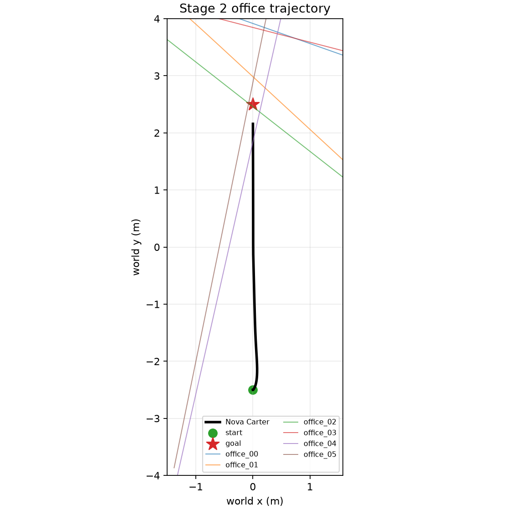
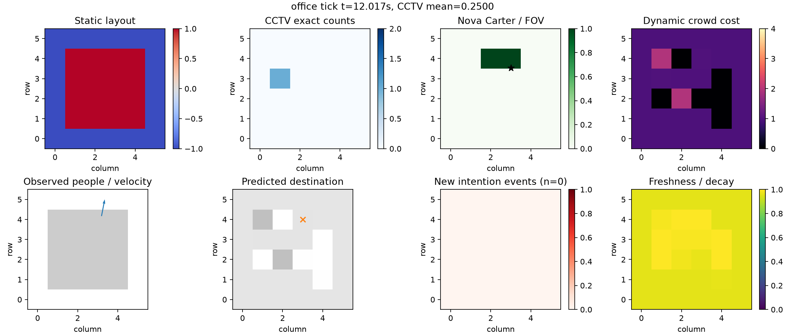
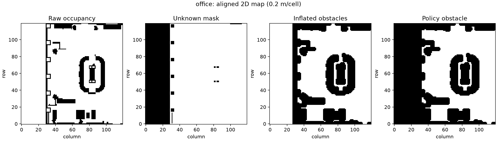

# VACaN

VACaN investigates inefficient DRL mobile-robot navigation decisions through
Congestion, Intention, and Freshness. Its research objective is spatial–temporal
failure localization and counterfactual intervention; it is not a proposal for
a new DRL algorithm.

## Current status

Stages 0, 1, 2, and 3 are **complete**. Stage 2 acceptance passes for Office,
Hospital, and Warehouse. Stage 3 produces deterministic 5 Hz dynamic costmaps
from exact virtual CCTV counts, noisy virtual robot FOV observations, constant-
velocity intention events, and 300-second linear freshness decay. Stage 1
acceptance passed on 2026-10-30 with
the official Isaac Sim Office, Hospital, and Warehouse assets, six Pegasus
people per scene, complete robot-independent Ground Truth, and exact
same-seed replay of all recorded trajectories and density grids. No other
simulator is used as a fallback.

| Component | Stage 0 target | Current host |
|---|---:|---|
| Isaac Sim | 5.1.0 | installed and GPU smoke-tested |
| Isaac Lab | 2.3.2 | installed from `/home/engineer/IsaacLab` |
| Pegasus Simulator | 5.1.0 | installed, commit `644da37e` |
| Python | Isaac Sim bundled 3.11 | 3.11.13 |
| PyTorch | 2.7.x, cu128 | 2.7.0+cu128 |
| Robot | NVIDIA Nova Carter | spawned; transform read successfully |

## Start here

The repository is an implementation snapshot, not a self-contained simulator
distribution. Isaac Sim assets, Isaac Lab, and Pegasus must be installed
separately. Read these documents in order:

| Document | Purpose |
|---|---|
| [Reproduction guide](docs/reproduction-guide.md) | Install the pinned stack and reproduce Stages 0–5 in dependency order. |
| [Architecture](docs/architecture.md) | Understand observed state, privileged Ground Truth, module boundaries, and data flow. |
| [Web development guide](docs/web-development.md) | Build visual analytics without mixing policy-visible and privileged data. |
| [Repository scope](REPOSITORY_SCOPE.md) | See exactly what is included and intentionally omitted from Git. |
| [Stage reports](docs/stage-0-report.md) | Inspect exact commands, actual results, artifacts, limitations, and next-stage requirements. |

The shortest host-only verification is:

```bash
uv venv --python python3.11 .venv
uv pip install --python .venv/bin/python -r requirements/stage0.txt
uv pip install --python .venv/bin/python -e '.[dev,rl,simulation]'
.venv/bin/pytest -q
```

The full simulator pipeline is intentionally sequential:

```text
Stage 0 runtime smoke
  -> Stage 1 official scenes + deterministic pedestrian routes
  -> Stage 2 Nova Carter differential-drive episodes
  -> Stage 3 congestion/intention/freshness costmaps
  -> Stage 4 static map + policy observation/action/reward contracts
  -> Stage 5 Recurrent PPO training and held-out evaluation
```

Do not continue to the next stage when the current stage validator fails. The
commands and acceptance checks for every transition are in the
[reproduction guide](docs/reproduction-guide.md).

## Visual evidence

The following files are compact copies of actual generated artifacts. They are
included to explain the pipeline and support frontend work; they are not a
substitute for rerunning acceptance tests.

| Stage 2 trajectory overview | Stage 3 factor-aware costmap | Stage 4 static map |
|---|---|---|
|  |  |  |

- [Play/download the 12.2-second Office Stage 3 costmap replay](docs/media/office-stage3-costmap-replay.mp4).
- [Browse all included media and provenance](docs/media/README.md).
- [Browse browser-oriented JSON/JSONL/PNG fixtures](examples/web-data/README.md).

No simulator-camera recording was present in the retained artifacts. The MP4
is a 5 Hz replay generated from Stage 3 costmap PNG frames and must not be
described as camera footage.

See [the Stage 0 report](docs/stage-0-report.md) for the evidence, compatibility
matrix, asset paths, and acceptance-test status.

See [the Stage 1 report](docs/stage-1-report.md) for scenario details, actual
commands, performance, artifacts, validation evidence, and limitations.

See [the Stage 2 report](docs/stage-2-report.md) for the Nova Carter action,
reset/step interface, runtime commands, and acceptance evidence. Stage 2 does
not train a policy.

See [the Stage 3 report](docs/stage-3-report.md) for the costmap contract,
validation evidence, artifacts, performance, and known geometry limitations.

## Stage 3 dynamic costmap

Stage 3 replays the synchronized Stage 2 state logs; it does not render camera
images, run computer vision, train a neural model, or expose privileged Ground
Truth to the policy costmap.

```bash
.venv/bin/python scripts/run_stage3_costmaps.py \
  --scenario all --output artifacts/stage3
.venv/bin/python scripts/validate_stage3.py artifacts/stage3
```

Each environment also contains `frames/`, with one PNG per 5 Hz costmap update
and a `frames.json` timestamp index.

## Stage 2 Nova Carter validation

The launcher reads Isaac Sim and Pegasus from the Isaac Lab checkout but writes
only under this VACaN repository. It does not install into or modify Isaac Lab:

```bash
.venv/bin/python scripts/run_stage2_scenarios.py \
  --scenario all --split train --episodes 1 \
  --output artifacts/stage2-isaac --headless
.venv/bin/python scripts/validate_stage2.py artifacts/stage2-isaac
```

To inspect the exact child commands without starting Isaac Sim, add `--dry-run`.
Each real episode uses an isolated Isaac Sim process and writes `summary.json`,
`trajectory.jsonl`, `isaac-sim.log`, `scenario.yaml`, and `top_down.png` under
VACaN. The policy observation contains robot proprioception and relative goal;
pedestrian Ground Truth is retained only under the separate `privileged_log`.

## Stage 1 dataset generation

Run one full training episode for each environment and independently replay
the resolved NavMesh routes to verify reproducibility:

```bash
.venv/bin/python scripts/run_stage1_scenarios.py \
  --scenario all --split train --episodes 1 \
  --output artifacts/stage1-isaac --headless \
  --verify-reproducibility
.venv/bin/python scripts/validate_stage1.py artifacts/stage1-isaac
```

Use `--split validation`, `--split test`, or `--split all` for the independent
seed sets in each scenario YAML. `--episodes` is capped by the number of seeds
defined for the selected split. Every episode contains `ground_truth.jsonl`,
`resolved_routes.json`, `scenario.yaml`, `summary.json`, `isaac-sim.log`, and
`top_down.png`. Repeated runs are retained under
`artifacts/stage1-isaac/reproducibility/`.

## Host-side checks

The lightweight `.venv` is only for configuration, metadata, and unit tests:

```bash
uv venv --python python3.11 .venv
uv pip install --python .venv/bin/python -r requirements/stage0.txt
uv pip install --python .venv/bin/python -e .
.venv/bin/python scripts/check_stage0_host.py \
  --output artifacts/stage0/host-inspection.json
.venv/bin/pytest -q
```

The host checker may still report unavailable GPU access when run inside a
sandboxed coding-agent process. The two host-terminal smoke results under
`artifacts/stage0/` are the authoritative GPU evidence.

## Isaac Sim 5.1 setup (large download)

First make `nvidia-smi` work. Then download the official standalone runtime;
this is intentionally a user-run command because the archive is large:

```bash
mkdir -p "$HOME/Downloads/isaac-sim-5.1.0" "$HOME/isaacsim-5.1.0"
cd "$HOME/Downloads/isaac-sim-5.1.0"
wget https://download.isaacsim.omniverse.nvidia.com/isaac-sim-standalone-5.1.0-linux-x86_64.zip
unzip isaac-sim-standalone-5.1.0-linux-x86_64.zip -d "$HOME/isaacsim-5.1.0"
cd "$HOME/isaacsim-5.1.0"
./post_install.sh
ln -s "$HOME/isaacsim-5.1.0" /home/engineer/IsaacLab/_isaac_sim
```

Use the already present Pegasus 5.1.0 tree and install Isaac Lab into the
Isaac Sim interpreter only after the runtime is linked:

```bash
cd /home/engineer/IsaacLab
./_isaac_sim/python.sh -m pip install --no-build-isolation -e source/isaaclab
export ISAACSIM_PATH="$(readlink -f ./_isaac_sim)"
./_isaac_sim/python.sh -m pip install --no-build-isolation -e \
  external/PegasusSimulator/extensions/pegasus.simulator
./_isaac_sim/python.sh -m pip install h5py==3.14.0
```

Do not use `isaaclab.sh -p` while Conda is active: it can select Conda's
Python instead of Isaac Sim's bundled interpreter. Do not install Isaac Sim
into VACaN's `.venv`.

## Mandatory integration test

The launcher performs **two independent runs**, each loading the official
Warehouse USD, spawning Nova Carter and a Pegasus person, stepping the world,
checking pedestrian displacement, reading both transforms, and closing the
application:

```bash
bash scripts/run_stage0_smoke.sh
```

The workstation policy assigns GPU 1 (PCI `0000:73:00.0`, the second 24 GB RTX
3090) to VACaN and Xorg, with a visible Isaac Sim window by default. GPU 2
(T1000) is rejected by the runner and is not used by Isaac Sim.

Do not prefix this command with `CUDA_VISIBLE_DEVICES`. The other RTX 3090 can
be selected explicitly with `VACAN_GPU_INDEX=0`; indices other than 0 or 1 are
rejected. A ROS2 Bridge startup warning is expected when ROS2 is not installed
and does not affect this non-ROS pedestrian smoke test.

On this workstation, Xorg uses the T1000 at PCI bus `a6` (Isaac Sim GPU index
2) as the display GPU. Do **not** use that GPU for VACaN: it has 8 GB VRAM and
no RT Cores, while Isaac Sim 5.1 requires an RTX GPU and lists 16 GB VRAM as
its minimum. Move the monitor cable to GPU 1 and configure Xorg for
`PCI:115:0:0` before using the configured visible execution path:

```bash
bash scripts/run_stage0_smoke.sh
```

For a local Isaac Sim window, connect the display to an RTX 3090 and configure
that card as the Xorg display GPU as described below. For compute-only execution
afterward, use `VACAN_HEADLESS=1 bash scripts/run_stage0_smoke.sh`. Selecting
the T1000 merely to obtain a window is not a valid workaround. See the
[Isaac Sim 5.1 requirements](https://docs.isaacsim.omniverse.nvidia.com/5.1.0/installation/requirements.html).

### Move Xorg to GPU 1

GPU 1 is PCI `0000:73:00.0`; Xorg's decimal BusID form is `PCI:115:0:0`.
Power the workstation off, move the monitor cable from the T1000 to that RTX
3090, boot again, and then back up and regenerate the Xorg configuration:

```bash
sudo cp -a /etc/X11/xorg.conf \
  /etc/X11/xorg.conf.vacan-t1000-backup-20261030
sudo nvidia-xconfig --busid=PCI:115:0:0
sudo reboot
```

After login, verify the mapping before launching Isaac Sim:

```bash
echo "$DISPLAY"
grep -n 'BusID' /etc/X11/xorg.conf
nvidia-smi --query-gpu=index,name,pci.bus_id,display_active \
  --format=csv,noheader
```

GPU 1 should report an active display. Then run the visible smoke test:

```bash
cd /home/engineer/VACaN
bash scripts/run_stage0_smoke.sh
```

If the graphical login fails, switch to a TTY with `Ctrl+Alt+F3`, restore the
backup, and reboot:

```bash
sudo cp -a /etc/X11/xorg.conf.vacan-t1000-backup-20261030 \
  /etc/X11/xorg.conf
sudo reboot
```

Results are written to `artifacts/stage0/smoke-run-1.json` and
`smoke-run-2.json`. Both recorded Stage 0 runs report `pass`; rerun this command
after dependency, driver, or asset changes.

## Package layout

Active boundaries are under `src/vacan/`: `simulation`, `pedestrians`, `robot`,
`sensors`, `mapping`, `prediction`, `rl`, `reference`, `counterfactual`, and
`analysis`. Ground Truth must remain outside the navigation policy interface.
Legacy reconstructed 2D files are retained for history but are not the Stage 1
backend or acceptance evidence.

## Stage 5 Recurrent PPO (in progress)

Stage 5 uses `sb3-contrib` Recurrent PPO with the verified two-channel Stage 4
map crop and robot vector. It starts with one isolated Isaac Sim environment and
does not install Python packages into the Isaac Lab checkout. Office, Hospital,
and Warehouse use independent policies; artifacts are isolated under
`artifacts/stage5/policies/<scenario>/`, and cross-environment checkpoint loads
are rejected before Isaac Sim starts. Run the first
physical smoke training only after all Stage 4 maps validate:

```bash
.venv/bin/python scripts/validate_stage4.py artifacts/stage4
.venv/bin/python scripts/run_stage5.py \
  --mode smoke --scenario office --phase dynamic_crowd \
  --seed 5101 --gpu 1 --headless
```

See `docs/stage-5-report.md`. Stage 5 is not complete until the physical smoke,
checkpoint reload, resume, and held-out evaluations pass.

## Stage 6 Office reference evaluation

Stage 6 freezes the selected Office policy and compares its physically executed
trajectory with a time-expanded full-information reference planner using one
shared navigation cost. The reference planner is an auxiliary efficiency
comparator and is not claimed to be globally optimal.

```bash
.venv/bin/python scripts/run_stage6_office.py \
  --seed 15101 --gpu 1 --headless
```

See `docs/stage-6-report.md`.

## Stage 7 Office frozen-policy comparison

Stage 7 compares Actual, Full-information, Congestion-error, Intention-error,
and Combined-error inputs using one frozen Office Recurrent PPO policy. It also
includes paired branches for three case studies: explicit counterfactual CCTV
corruption, intention-induced freshness error under partial coverage, and
Full-information DRL versus the Stage 6 time-expanded A* reference. Exact CCTV
remains the base assumption; the corruption branch is isolated and labeled.

The repository contains the selected policy, Office occupancy map, and minimum
matched Stage 6 records required for host decision replay:

```bash
git lfs install
git lfs pull
.venv/bin/python scripts/analyze_stage7_office_decisions.py \
  --output artifacts/stage7/office/decision
```

The full closed-loop Isaac Sim rerun additionally requires Isaac Sim 5.1,
Isaac Lab 2.3.2, Pegasus 5.1, and access to the official NVIDIA assets:

```bash
.venv/bin/python scripts/run_stage7_office.py \
  --seed 15101 --gpu 1 --headless
```

See `docs/stage-7-report.md`. The redesigned closed-loop run remains pending;
Stage 8 has not started.
